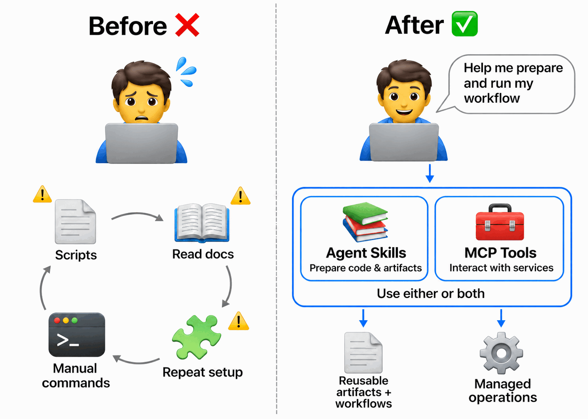

# KEP-467: Kubeflow MCP Server and Agent Skills

- **Authors:** Abhijeet Dhumal (@abhijeet-dhumal)
- **Status:** provisional
- **Review and ownership:** Kubeflow Agents Working Group, in
  coordination with WG ML Experience and component owners (agreement pending)
- **Tracking issue:** [kubeflow/mcp-server#467](https://github.com/kubeflow/mcp-server/issues/467)
- **Created:** 2026-10-29

## Summary

This KEP proposes adding a GitHub-hosted catalog of reusable skills alongside the Kubeflow MCP
server, using the vendor-neutral [Agent Skills format](https://agentskills.io/specification).
Skills help agents prepare Kubeflow artifacts; the MCP server exposes Kubeflow operations.
Maintainers release them independently, and users can install either or both.



## Motivation

The MCP server exposes Kubeflow operations to agents; skills guide reusable workflows such as
adapting training code. Keeping both in one project gives users one place to find Kubeflow agent support
while allowing independent installation and releases.

### Goals

- Publish standalone skills for Kubeflow workflows, starting with Trainer script adaptation.
- Distribute skills through GitHub-hosted client marketplace catalogs. Keep direct skill-folder
  installation available for compatible clients, and release plugins separately from the MCP server.
- Define ownership, compatibility, and validation requirements for the catalog. Record MCP
  dependencies per skill so skills remain independent unless a workflow requires server access.

### Non-Goals

- Building a hosted registry or a universal marketplace, search service, or installer.
- Requiring skills to call, wrap, or duplicate MCP tools; changing existing MCP tools or their schemas.
- Having skills submit or manage Kubeflow workloads.

## Proposal

Keep the MCP server and skills in one repository, but package and release them separately. This
extends the project scope of [KEP-936](https://github.com/kubeflow/community/tree/master/proposals/936-kubeflow-mcp-server)
to include independently usable skills that create or transform Kubeflow artifacts.

### Skill Packages and Catalog

Store plugins under `plugins/<plugin-name>/`, with skills at
`plugins/<plugin-name>/skills/<skill-name>/SKILL.md`. Start with a portable `training` plugin.
GitHub-hosted client marketplaces point to these packages. Users can also copy a skill folder and its
support files into a compatible agent's standard skills directory.

The GitHub repository is the source of truth for Kubeflow-owned skills, versions, compatibility, and
support. Third-party directories such as [skills.sh](https://www.skills.sh/) may aid discovery but do
not replace Kubeflow review. Link to upstream skills that meet the required outcomes; bundle them only
with their owners' agreement.

### Relationship to MCP

The initial Trainer skill does not require MCP. For future skills, the catalog marks the dependency as standalone,
MCP optional, or MCP required. A skill that needs MCP must name the required server capability and
minimum compatible version. It remains an independent workflow and does not wrap or duplicate MCP
tools.

MCP exposure through the read-only [Skills extension](https://modelcontextprotocol.io/seps/2640-skills-extension)
is an optional follow-up.

### User Stories

#### Story 1: ML Engineer — Convert a Python Script into a Kubeflow Callable

**Requests**

> “Convert this Python training script into a self-contained function for the Kubeflow SDK.”
>
> “Also adapt it for 2 nodes with 4 GPUs each.”

**Skill behavior**

Convert supported scripts into a self-contained `train()` callable for
[`CustomTrainer(func=train)`](https://sdk.kubeflow.org/en/latest/train/custom-training.html),
with explicit inputs and enclosed imports, helpers, and setup. When requested, add distributed
PyTorch rank/device handling, data sharding, and process-group setup and cleanup.
The callable can also supply a KFP component's workload; pipeline generation remains in Story 2.

**Result**

Return the callable, its input arguments, dependencies, and assumptions. For Trainer, include the
runtime and a separate configuration; for the distributed example, use `torch-distributed`,
`num_nodes=2`, and `resources_per_node={"gpu": 4}`. Explain changes to batch size, data loading, and
checkpoint behavior where needed. Identify missing prerequisites and unsupported input patterns.

**Scope**

Prepare code for review without submitting a job or duplicating the MCP tool's execution wrapper.
Distributed adaptation is optional; callable conversion is useful on its own. Pipeline generation
and compilation remain in Story 2.

#### Story 2: Data Scientist — Generate a KFP Pipeline (Candidate)

**Request**

> “Turn this annotated notebook into a compiled KFP v2 pipeline.”

**Skill behavior**

Use [Kale](https://kale.kubeflow.org/en/latest/) when it fits. Otherwise, generate KFP DSL from the
workflow, then compile and validate it locally using the
[KFP compilation workflow](https://www.kubeflow.org/docs/components/pipelines/user-guides/core-functions/compile-a-pipeline/).

**Result**

Return pipeline source and compiled YAML.

**Scope and status**

Stop before upload or execution. Include this skill only if a maintained upstream skill meets that
requirement.

#### Story 3: ML Researcher — Prepare Optimizer Inputs (Future Candidate)

**Request**

> “Set up a search over learning rate and batch size to maximize validation accuracy.”

**Skill behavior**

Prepare a `TrainJobTemplate`, search-space mapping, and objectives using the pinned SDK's Optimizer
types. Check bounds and metric direction; confirm the API version before implementation.

**Result**

Return the validated template, search space, and objectives for the user to review.

**Scope**

Do not call `OptimizerClient.optimize()`, which creates and submits the job.

#### Story 4: Model Developer — Prepare Model Registry Metadata (Future Candidate)

**Request**

> “Prepare registration metadata for this fraud-detector v1 artifact and its metrics.”

**Skill behavior**

Prepare the model name, remote artifact URI, version, and optional format or scalar metadata for
[`ModelRegistryClient.register_model`](https://sdk.kubeflow.org/en/latest/hub/api.html). This requires
the optional `kubeflow[hub]` extra.

**Result**

Return registration metadata for review.

**Scope**

Do not access artifact storage or register the model. This skill remains independent of the MCP
server's Hub client, which is currently a stub.

### Open Questions

- **KFP skill source:** Confirm the upstream repository and owner, and verify that its skill supports
  artifact generation and local validation without submitting or running a pipeline. Bundle it only
  with its owner's agreement.
- **Project ownership:** Confirm ownership and review responsibilities with the proposed owning groups.
- **Optional project rename:** Keep the current project name or consider **Kubeflow AgentHub** to
  reflect the broader scope. Naming is a separate decision and does not block skill delivery.

### Risks and Mitigations

- **Stale or duplicate skills:** require component-owner review and keep one canonical source.
- **Client differences:** maintain a tested support matrix; do not promise a universal install command.
- **Trust and distribution:** review and version skills. Installing a skill does not configure
  Kubernetes credentials or access; instructions use tools already available to the agent. MCP calls
  remain subject to the server's authorization and confirmation policies.

## Design Details

The [implementation plan](IMPLEMENTATION_PLAN.md) covers the package layout, delivery phases, and
release criteria.

## Distribution and Installation

Install the skill plugin and MCP server separately; users can choose either or both. The proposed
marketplace identifier is `kubeflow-mcp`, following the current project name. These commands describe
installation after the catalogs and plugin are published; this proposal alone does not provide them.
Record tested client versions before claiming support.

### Claude Code

```bash
claude plugin marketplace add kubeflow/mcp-server
claude plugin install training@kubeflow-mcp
```

### Codex CLI

```bash
codex plugin marketplace add kubeflow/mcp-server
codex plugin add training@kubeflow-mcp
```

### Optional MCP Server Setup

For MCP operations, install the server and register it with your client:

```bash
pip install kubeflow-mcp
```

```bash
claude mcp add --transport stdio kubeflow -- kubeflow-mcp serve
```

For Codex CLI ([MCP setup](https://developers.openai.com/codex/mcp)):

```bash
codex mcp add kubeflow -- kubeflow-mcp serve
```

The `kubeflow-mcp` executable must be on the client's `PATH`; for a virtual environment, use its
full executable path.

### Direct Skill Installation

Users who prefer direct skill installation can copy the complete skill folder into the client's
standard project or user skills directory:

| Client | Project skill directory | User skill directory |
| --- | --- | --- |
| Claude Code | `.claude/skills/<skill-name>/` | `~/.claude/skills/<skill-name>/` |
| Codex CLI   | `.agents/skills/<skill-name>/` | `~/.agents/skills/<skill-name>/` |

Copy the whole skill directory so relative references remain available. Software dependencies and
MCP connections are separate prerequisites.

## Test Plan

The [implementation plan](IMPLEMENTATION_PLAN.md) defines validation and release checks.

- [ ] I/we understand the involved component owners may require updates to existing tests before
implementation.

Validate package contents, client loading, and generated Trainer artifacts. Evaluations cover supported
scripts, unsupported inputs, and missing prerequisites. Verify that the returned function and separate
configuration work with the supported SDK without submitting a workload. Distributed GPU claims also
require a successful multi-node GPU run. Optional MCP exposure requires extension conformance.

## Graduation Criteria

Delivery requires a published, versioned training plugin, verified client installation, passing Trainer
output evaluations, and named maintainers. It must work without MCP. Ongoing maintenance includes a
current compatibility matrix and reproducible releases. See the
[implementation plan](IMPLEMENTATION_PLAN.md#acceptance-criteria) for the acceptance checks.

## Drawbacks

- Maintainers of `kubeflow/mcp-server` would take on skill and client-compatibility maintenance.
- A dedicated skills repository may be a better home if ownership or catalog size grows.

## Alternatives

- **Separate skills repository:** separates component ownership, but splits the initial catalog from
  the MCP project and adds another repository to maintain.
- **MCP resources only:** does not support native Agent Skills loading.
- **Hosted marketplace:** adds service and maintenance work before GitHub browsing requires it.

## References

- [Kubeflow Agents Working Group](https://github.com/kubeflow/community/tree/master/wg-agents)
- [Agent Skills specification](https://agentskills.io/specification)
- [Agent Plugins v1 specification](https://agent-plugins.org/specification)
- [skills.sh](https://www.skills.sh/): third-party discovery directory for agent skills
- [Microsoft Agent Skills repository](https://github.com/microsoft/skills): skills, plugins, MCP configuration, and skill evaluations in one project
- [Anthropic skills repository](https://github.com/anthropics/skills): standalone skills distributed through a client marketplace
- [Claude Code plugin marketplaces](https://code.claude.com/docs/en/plugin-marketplaces)
- [Codex plugin packaging and marketplace guide](https://developers.openai.com/plugins/build/plugins)
- [SEP-2640: MCP Skills Extension](https://modelcontextprotocol.io/seps/2640-skills-extension)
- [Kubeflow MCP Server KEP-936](https://github.com/kubeflow/community/tree/master/proposals/936-kubeflow-mcp-server)
- [Kubeflow Pipelines skill PR #13653](https://github.com/kubeflow/pipelines/pull/13653): example of
  pipeline generation and a compile/fix loop
- [Kubeflow MCP Pipelines client PR #468](https://github.com/kubeflow/mcp-server/pull/468): pipeline
  discovery and run lifecycle support
